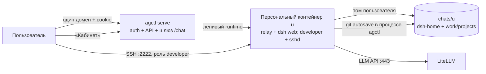

# agctl

**Платформа ИИ для организации одним Go-бинарём.** Единая модель v3: после
входа каждый пользователь получает **свой персональный контейнер** DeepSeek
Harness — он лениво поднимается при открытии чата, засыпает после часа
простоя, а данные (сессии, файлы, настройки) живут на постоянном томе
независимо от контейнера. Папки в чате — это каталоги рабочей области.

Роль **developer** (заявка → апрув администратора → постоянная привязка к
учётке) добавляет к тому же контейнеру sshd (key-only SSH к `127.0.0.1`),
IDE-канал и доступ к проектным каталогам. Отдельные dev-контейнеры и создание
legacy-рабочих мест в v3 демонтированы. Git/autosave хранит локальную
историю проектов, обычному пользователю git-интерфейс не показывается; выбор
шаблона проекта пока остался в legacy-каталоге комплектов.

Плагин «Кабинет» теперь управляет заявкой на developer, SSH-ключом и
проектами. Experimental local-backend-код сохранён, но не входит в текущий
пользовательский поток — его архитектуру владелец решила рассмотреть позже.



## Документация

| Документ | О чём |
|---|---|
| [docs/architecture.md](docs/architecture.md) | **Текущая архитектура v3**: единый runtime пользователя, роли, проекты, SSH, шлюзы и healthcheck — с точными ссылками на код. Физической карте соответствует файл `system/map/agctl-processes.html` |
| [docs/architecture-roadmap.md](docs/architecture-roadmap.md) | **Архитектурный роадмап**: где мы сейчас, горизонты 1–3, принципы |
| [docs/capacity.md](docs/capacity.md) | Оценка ресурсов по числу пользователей |
| [docs/secure-gateway.md](docs/secure-gateway.md) | Схема шлюза и cookie-mint |
| Карта системы — `make map` | Открывает физическую карту (процессы, порты, протоколы — `system/map/agctl-processes.html`); на работающем сервере она же — страница `/map` за сессией |

## Быстрый старт (ноутбук, ~10 минут)

Нужно: **Go 1.27+**, **Docker** (Docker Desktop / dockerd), **Node 22+**
(для сборки UI).

```bash
git clone https://github.com/arijjia/agctl && cd agctl
make up              # соберёт UI, бинарь и поднимет платформу: http://127.0.0.1:8929
```

Дом платформы — `~/.agctl` (создаётся сам), образом agctl-dsh при первом
старте контейнера сервер обзаведётся тоже сам. Остановка — `make stop`.

### Запуск с корпоративными моделями (qwens через LiteLLM)

Ключ складывается в `.env` (в git не попадает — pre-commit и .gitignore
страховуют) и подхватывается автоматически:

```bash
cp .env.example .env          # и впиши AGCTL_LLM_API_KEY=sk-…
make corp                     # фоновый запуск с корп. LiteLLM на :8929
make logs                     # хвост лога; остановка — make stop
```

Дефолты провайдера — в `bin/run.mk`. Свой набор можно задать в `.env`
(`AGCTL_LLM_BASE_URL`, `AGCTL_LLM_MODELS`, `AGCTL_LLM_MODEL`) и запускать
`make up`.

Ключ нужен только при первом таком запуске: провайдер сохраняется
зашифрованным в SQLite и при следующих рестартах восстанавливается
автоматически (env/флаги можно не передавать). Пользователи без личного
секрета сразу получают корпоративные модели — dsh-модал «Add an API key»
не появляется.

Если чат не поднимается:

- страница открылась, а чат молчит — проверьте, что **Docker запущен**:
  чат-контейнер ленивый и без Docker не стартует;
- «Личный чат запускается…» дольше минуты — если Docker Desktop
  перезапускался, рантайм пересоздастся сам (до ~1 минуты); не закрывайте
  страницу;
- модели отвечают «Connection error» — проверьте **VPN**: имя
  `litellm-dev.utmn.ru` резолвится только в корпоративной сети. Контейнер,
  созданный без VPN, получит пин корпоративного хоста при следующем
  пересоздании (сон по TTL или `docker rm agctl-chat-…`).

### Ежедневный запуск (свой дом `~/.agctl`)

```bash
make up        # собрать и поднять платформу в фоне (:8929, лог .runtime/up.log)
make status    # что запущено: make-инстансы + контейнеры
make logs      # хвост лога (другой инстанс: make logs LOG=.runtime/corp.log)
make stop      # аккуратный останов (SIGTERM; чат-контейнеры сервер закроет сам)
make down      # остановить всё, включая контейнеры мест (тома остаются на диске)
make restart   # stop + up
```

`make stop` останавливает только инстансы, поднятые make (pidfile в
`.runtime/`); сервер, запущенный вручную в терминале, останавливается своим
Ctrl+C так же корректно.

### Персональный контейнер, проекты и Кабинет

- Каждый аккаунт работает в **одном персональном dsh-контейнере**. Он
  поднимается лениво при открытии `/chat/`, засыпает через 60 минут простоя;
  `dsh-home` и рабочий том остаются на диске.
- Дерево в боковой панели — реальные **проекты-папки**: каждая папка
  соответствует каталогу `/workspace/<имя>` и DSH Workspace. Новая сессия,
  созданная внутри папки, получает cwd этого проекта. Инструкции проекта
  лежат в его `AGENTS.local.md`; локальный Git-автосейв коммитит изменения
  каждые две минуты. Для роли `user` Git-интерфейс не показывается.
  «Скрыть папку» прячет её из дерева, но не удаляет каталог, файлы или историю.
- В **Кабинете**: подача заявки на роль developer; для developer/admin —
  SSH-ключ и проекты (создание/список). Отдельные рабочие места и режим
  `/w/{id}` в v3 демонтированы; старые записи пока доступны только для
  совместимости, новые не создаются.
- Роль **developer** выдаётся после апрува администратором и привязана к
  учётке. Она включает sshd в том же контейнере; порт публикуется только на
  `127.0.0.1` хоста. Local backend-код остаётся experimental, но его
  пользовательский сценарий отложен.

Откройте **http://127.0.0.1:8929**:

1. Первый пользователь становится администратором.
2. После входа корень направляет в `/chat/`. Личный dsh-runtime лениво
   поднимается при первом открытии; сессии и файлы переживают сон.
3. Чтобы получить SSH и developer-инструменты, откройте «Кабинет» →
   «Заявка на роль developer». После апрува задайте публичный SSH-ключ.
4. Создайте проект в Кабинете или добавьте папку в дереве чата. Новые
   сессии в этой папке работают в каталоге проекта; файлы и локальная
   Git-история хранятся в персональном томе.

Агент ведёт задачи через `agctl backlog`; Git-автосейв проектов выполняется
внутри процесса agctl (go-git), отдельный Git-процесс и bare-origin не нужны.

Данные живут в `$AGCTL_HOME` (по умолчанию `~/.agctl`):

```
agctl.db                            SQLite: учётки/роли, настройки, заявки
secrets.key                         мастер-ключ шифрования (0600)
chats/u<userID>/dsh-home            сессии, настройки, плагины DSH
chats/u<userID>/work/.sessions/     скрытые каталоги неклассифицированных сессий
chats/u<userID>/work/<project>/     проектный каталог + локальная .git-история
repos/ и work/<id>/                 только остатки legacy-рабочих мест; новый v3 их не создаёт
```

DSH и процессы-дети работают через RW bind mounts напрямую: файлы DSH —
`/home/dsh`, проекты — `/workspace`; файловые записи не проксируются через
`agctl serve`. Предложенный target layout `$AGCTL_HOME/u<ID>/{dsh-home,workspace}`
пока не мигрирован: source snapshot всё ещё использует `chats/u<ID>/{dsh-home,work}`.

## Роли: user / developer / admin

| Роль | Что видит | Runtime и данные |
|---|---|---|
| **user** (по умолчанию) | личный чат dsh через `/chat/`, папки-проекты | один ленивый персональный контейнер; `chats/u<ID>/dsh-home` переживает сон/удаление; git не показывается |
| **developer** (по заявке + апрув админа, привязана к учётке) | то же + SSH-канал, проекты и локальная Git-история | тот же персональный контейнер + sshd (key-only, порт на loopback); без дополнительных контейнеров на проекты |
| **admin** | всё + админка (пользователи, заявки, аудит) | — |

Заявка на роль: `POST /api/role-requests` (в Кабинете — волна C UI); апрув —
`POST /api/role-requests/{id}/approve`. SSH-ключ разработчика: `PUT
/api/me/ssh` — контейнер поднимет sshd при следующем старте, порт в ответе
(`sshPort`, публикуется только на loopback хоста).

Панель «Кабинет» — dsh client-plugin в боковой панели. Основной origin один:
`/chat/` ведёт в персональный контейнер, `/api/*` обслуживает auth, заявки,
проекты и SSH. Старый `/w/{id}/` оставлен как compat-proxy для уже
существующих записей, но создание/изменение legacy-workspaces возвращает 410.
Исходник плагина: `dsh-plugins/cabinet/`.

**Папка = проектный каталог.** Новая сессия внутри секции проекта получает
реальный DSH Workspace с cwd `/workspace/<project>`; session-files оставляет
этот cwd, а не создаёт `.sessions/<id>`. Сессии, которые не привязаны к
проекту, по-прежнему получают скрытый `.sessions/<sessionId>`. Локальный
Git-autosave проекта выполняется внутри go-процесса agctl каждые две минуты;
для роли user история не показывается. Квоты томов и activity-aware сон —
следующие эксплуатационные шаги. Детали — [docs/architecture.md](docs/architecture.md).

## Комплекты (остаток legacy)

Каталог комплектов `/api/kits` и код provision (`internal/provision/kits.go`)
пока сохранены для совместимости/переноса шаблонов. **Новый проект v3 сейчас
создаётся как каталог с README и локальным Git**; старые `base`/`1c-vibe`
комплекты ещё не подключены к созданию проектов. Подключение шаблонов
разработчика к проектному API — следующий шаг, а не создание отдельного
контейнера/рабочего места.

## Команды бинарника

```
agctl serve     # UI + API + личные runtime пользователей
agctl migrate   # накатить миграции SQLite
agctl backlog <new|list|top|check|start|done|cancel|note|migrate>
agctl connect --port SSH_PORT [--host HOST] [--identity KEY] [--print]
agctl local connect --server URL --grant TOKEN [--launch-dsh] [--dsh-token TOKEN]
agctl init-chat-home --home DSH_HOME   # внутренний: init-container K8s-чата
agctl sync create --name NAME --local DIR --port SSH_PORT [--host HOST] [--user root] [--print]
agctl sync list|pause|resume|flush|terminate [mutagen args]
agctl version
# agctl workspace create — legacy-команда отключена в v3
```

`agctl serve` — основные флаги:

| Флаг | Зачем |
|---|---|
| `--home DIR` | каталог данных (по умолчанию `~/.agctl`) |
| `--addr H:P` | слушающий адрес (по умолчанию `127.0.0.1:8929`) |
| `--image T` | тег образа персонального runtime (по умолчанию `agctl-dsh:0.2.0`) |
| `--bin-dir D` | каталог linux-сборок agctl для образа (по умолчанию `./dist`) |
| `--mem-gb N` / `--cpus N` | лимиты персонального контейнера (по умолчанию 2 ГБ / 2 CPU) |
| `--chat-ttl-min N` | idle TTL персонального контейнера, минуты (по умолчанию 60) |
| `--tier0=false` | отключить корневой маршрут в личный чат (для админ-only стенда) |
| `--secure-cookies` | флаг Secure у cookies (за HTTPS-ingress) |
| `--experimental-local-bridge` | experimental API-коннектора (по решению владельца локальный backend UX отложен; флаг по умолчанию выключен) |
| `--cors-origin LIST` | точные origins для панели Кабинета, через запятую; пусто = CORS выключен |
| `--llm-base-url URL` | OpenAI-совместимый провайдер чата по умолчанию (напр. корпоративный LiteLLM) |
| `--llm-models LIST` | модели чата по умолчанию через запятую; `--llm-model M` — какая из них основная |
| `--llm-api-key KEY` | ключ провайдера (лучше через env `AGCTL_LLM_API_KEY`); личный секрет пользователя перекрывает платформенный. Провайдер сохраняется зашифрованным в SQLite — при следующих рестартах без env/platform-флагов восстанавливается автоматически |

`agctl backlog` работает на хосте и **внутри персонального контейнера**
(бинарь в образе) — агент ведёт задачи проекта.

### SSH-канал роли developer (персональный контейнер)

1. Пользователь подаёт `POST /api/role-requests`; администратор подтверждает
   заявку. Роль `developer` сохраняется в учётной записи.
2. В Кабинете developer задаёт OpenSSH public key (`PUT /api/me/ssh`).
   Ключ сохраняется в SQLite; приватный ключ остаётся только у пользователя.
3. При следующем старте его **персонального** контейнера entrypoint запускает
   sshd только при наличии ключа. Root-вход — только public-key; пароль и
   forwarding запрещены. Порт `:2222` контейнера публикуется Docker только
   на `127.0.0.1` хоста; `GET /api/me/ssh` показывает `sshPort` (0, пока
   контейнер спит).

Подключение с сервера/хоста:

```sh
agctl connect --port <sshPort> --identity ~/.ssh/id_ed25519
```

С удалённой машины нужен доверенный туннель/VPN — `sshPort` не открыт в LAN
или Internet. Пример ручного туннеля:

```sh
ssh -L 22222:127.0.0.1:<sshPort> user@agctl-host
agctl connect --host 127.0.0.1 --port 22222 --identity KEY
```

Локальную папку можно синхронизировать с персональным `/workspace` через
[Mutagen](https://mutagen.io/documentation/synchronization/) (нужен установленный
[Mutagen CLI](https://mutagen.io/documentation/introduction/installation/)):

```sh
agctl sync create --name my-project --local ./project \
  --host 127.0.0.1 --port <sshPort> --user root
agctl sync list
agctl sync pause my-project
agctl sync terminate my-project
```

Сессия Mutagen — `two-way-safe`; `.git`, `node_modules`, `.env*`,
`.credentials.*` и `.ssh` исключены по умолчанию. Проекты хранятся в
`/workspace/<project>`; локальный Git-autosave версии проекта, но обычный
пользователь не видит Git-интерфейс. Для удалённой машины сначала подними
SSH-туннель и укажи его локальные host/port.

## Сборка и проверки

Все цели — `make help`.

| Цель | Что делает |
|---|---|
| `make hooks` | установить pre-commit hook: gofmt + go vet, node --check, тест синка плагинов ↔ dsh-skel, блок случайного коммита `.env` |
| `make go_build` / `go test ./...` | бинарь / полный Go-suite (включая роли, проекты, autosave, legacy tombstones) |
| `make web_build` | React SPA → `web/dist` → `go:embed` |
| `make img_build` | linux-сборка agctl + Docker-образ `agctl-dsh:0.2.0` (`IMG=agctl-dsh:X make img_build`) |
| `make release_local` | матрица darwin/linux/windows × arm64/amd64 в `dist/` |
| `node --test dsh-plugins/chat-brand/test/*.test.js` | smoke структуры дерева папок → DSH Workspace проекта |
| `node --test dsh-plugins/cabinet/test/*.test.cjs` | mock-тесты роли developer, SSH, проекты и отсутствия legacy UI |
| `node --test dsh-plugins/chat-session-files/test/*.test.js` | default-session cwd и сохранение cwd реального project Workspace |
| `scripts/e2e-local-bridge.sh` | experimental-тест локального backend (сценарий отложен; не часть v3 user flow) |
| `scripts/e2e-cabinet*.sh`, `scripts/e2e-ssh.sh` | старые e2e отдельных workspace/seat; требуют переписывания под v3, не текущий smoke |

`tests/e2e-ui` пока содержит сценарии до v3 (отдельное workspace + апрув).
Перед запуском их нужно переписать на поток «роль developer → проект-папка →
сессия в проектном cwd»; в CI сейчас проверяются unit/smoke-контракты выше.

Релизы по тегу — [goreleaser](.goreleaser.yaml) (CI: `.github/workflows/ci.yml`).

## Безопасность v3 и границы

- Изоляция — **контейнер на пользователя**; контейнер видит только его
  `dsh-home` и общий личный `work/` (проекты внутри одного аккаунта не
  являются отдельной security boundary).
- LLM-токен шифруется AES-256-GCM ключом `secrets.key` (0600), передаётся
  контейнеру через env, не попадает в Git или образ.
- Пароль — argon2id; сессии — HttpOnly-cookie; первый аккаунт — admin.
  `/api/*` проверяет сессию и роль на сервере: отсутствие кнопки никогда
  не считается защитой.
- `/chat/` — шлюз к персональному runtime; `/w/{id}` оставлен только для
  чтения/доступа к старым записям (новые места и их мутации — 410).
  Boot-токен dsh браузеру не отдаётся.
- SSH существует только для developer/admin с публичным ключом; sshd —
  key-only, порт :2222 контейнера опубликован только на loopback хоста.
- CORS — точный allow-list; wildcard с credentials запрещён.
- **Известные остаточные риски:** egress контейнеров пока открыт; нет MFA/SSO
  и HA control-plane; DSH boot-токен попадает в Docker logs (доступ к Docker
  daemon фактически равен правам администратора); agctl не терминирует TLS —
  production требует доверенный HTTPS ingress.

Подробно: [docs/secure-gateway.md](docs/secure-gateway.md),
[docs/architecture.md](docs/architecture.md),
[docs/capacity.md](docs/capacity.md), а сравнение целевой модели —
`agctl-hq/docs/v3/unified-runtime-model.md`. Стратегическая рамка — штаб
`agctl-hq/docs/agctl-platform-concept-v2.md`.

## Ограничения v3 (честно)

- Один контейнер на аккаунт; роль developer лишь добавляет sshd в тот же
  контейнер. SSH-порт `:2222` доступен только на loopback хоста — удалённой
  машине нужен доверенный туннель/VPN.
- TTL по умолчанию — 60 минут без HTTP/WS-активности через dsh. Открытая
  сессия браузера удерживает активный запрос; **активность исключительно по
  SSH сейчас не является отдельным heartbeat** — это риск для долгой IDE/
  терминальной работы, который нужно закрыть до расширенного пилота.
- Сессия без проектной папки получает `.sessions/<sessionId>`; сессия,
  созданная в папке-проекте, получает DSH Workspace с cwd
  `/workspace/<project>`. Файловые границы между проектами одного пользователя
  не являются границами безопасности.
- Git-проект создаётся с локальным `.git`; go-git делает autosave-коммиты
  каждые две минуты **без remote/push**. Для `user` Git остаётся невидимым.
  Каталог комплектов `/api/kits` пока legacy: выбор шаблона при создании
  проекта в v3 ещё не подключён.
- Перекидывание существующей сессии в другую папку меняет организацию в UI,
  но не переносит её файлы между каталогами. Пилот принят с чистого тома;
  миграции старых `chats/` и `work/` нет.
- Legacy `/w/{id}` и GET старых workspace-записей пока оставлены для
  совместимости/низкоуровневых тестов; создание/изменение seats и весь API
  заявок на места — 410. CLI `agctl workspace create` отключён.
- «Локальный backend» владелец решила осмыслить позже. Код остаётся за
  `--experimental-local-bridge` (выключен по умолчанию); это не текущий
  сценарий developer.
- **Kubernetes — только prototype:** `ChatProvider`/`StorageID` отделяют
  стабильный PVC от pod, но `cmd serve` выбирает Docker; нет live-cluster
  smoke, runtime selector, controller/leases, HA БД; NetworkPolicy prototype
  не ограничивает egress. Не считать production-ready.
- Прочие остаточные риски: egress Docker-контейнеров открыт; MFA/SSO и HA
  control-plane отсутствуют; boot-токен dsh виден в Docker logs (доступ к
  Docker daemon равен правам администратора); TLS завершается внешним ingress,
  не agctl.
- Персистентность проекта обеспечивается пользовательским томом; квоты томов,
  retention, activity-aware TTL/продление lease по SSH и полноценный prewarm
  остаются следующими шагами (эпик `v3-unified-runtime`).

## Лицензия

[MIT](LICENSE)
