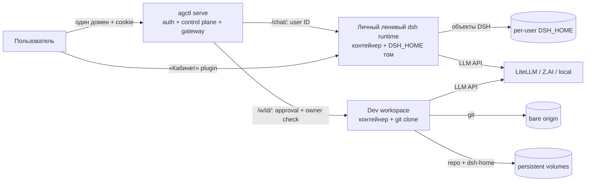

# agctl

**Платформа ИИ для организации одним Go-бинарём.** Два режима на одном
домене: (1) после входа сразу открывается личный чат DeepSeek Harness;
(2) разработчик из плагина «Кабинет» создаёт отдельное git-backed рабочее
место с dsh web, терминалом, SSH и IDE-петлёй. Чат runtime лениво поднимается
на пользователя и засыпает по TTL; DSH_HOME и пользовательские данные живут
на постоянном томе независимо от контейнера.

Плагин «Кабинет» вшит в скелет каждого dsh-home: можно создавать места,
передавать LLM-провайдер и SSH public key из интерфейса DSH.



## Документация

| Документ | О чём |
|---|---|
| [docs/architecture.md](docs/architecture.md) | **Текущая архитектура**: два режима, шлюзы, чат-runtime, режим разработки, local backend, K8s-прототип — с точными ссылками на код. Этому документу соответствует карта системы |
| [docs/architecture-roadmap.md](docs/architecture-roadmap.md) | **Архитектурный роадмап**: где мы сейчас, горизонты 1–3, принципы |
| [docs/capacity.md](docs/capacity.md) | Оценка ресурсов по числу пользователей |
| [docs/secure-gateway.md](docs/secure-gateway.md) | Схема шлюза и cookie-mint |
| Карта системы — `make map` | Открывает физическую карту (процессы, порты, протоколы — `system/map/agctl-processes.html`); на работающем сервере она же — страница `/map` за сессией |

## Быстрый старт (ноутбук, ~10 минут)

Нужно: **Go 1.27+**, **Docker** (Docker Desktop / dockerd), **Node 22+**
(для сборки UI).

```bash
git clone https://github.com/arijjia/agctl && cd agctl
make up              # соберёт UI, бинарь и поднимет платформу: http://127.0.0.1:8929
```

Дом платформы — `~/.agctl` (создаётся сам), образом agctl-dsh при первом
старте контейнера сервер обзаведётся тоже сам. Остановка — `make stop`.

### Запуск с корпоративными моделями (qwens через LiteLLM)

Ключ складывается в `.env` (в git не попадает — pre-commit и .gitignore
страховуют) и подхватывается автоматически:

```bash
cp .env.example .env          # и впиши AGCTL_LLM_API_KEY=sk-…
make corp                     # фоновый запуск с корп. LiteLLM на :8929
make logs                     # хвост лога; остановка — make stop
```

Дефолты провайдера — в `bin/run.mk`. Свой набор можно задать в `.env`
(`AGCTL_LLM_BASE_URL`, `AGCTL_LLM_MODELS`, `AGCTL_LLM_MODEL`) и запускать
`make up`.

Ключ нужен только при первом таком запуске: провайдер сохраняется
зашифрованным в SQLite и при следующих рестартах восстанавливается
автоматически (env/флаги можно не передавать). Пользователи без личного
секрета сразу получают корпоративные модели — dsh-модал «Add an API key»
не появляется.

Если чат не поднимается:

- страница открылась, а чат молчит — проверьте, что **Docker запущен**:
  чат-контейнер ленивый и без Docker не стартует;
- «Личный чат запускается…» дольше минуты — если Docker Desktop
  перезапускался, рантайм пересоздастся сам (до ~1 минуты); не закрывайте
  страницу;
- модели отвечают «Connection error» — проверьте **VPN**: имя
  `litellm-dev.utmn.ru` резолвится только в корпоративной сети. Контейнер,
  созданный без VPN, получит пин корпоративного хоста при следующем
  пересоздании (сон по TTL или `docker rm agctl-chat-…`).

### Ежедневный запуск (свой дом `~/.agctl`)

```bash
make up        # собрать и поднять платформу в фоне (:8929, лог .runtime/up.log)
make status    # что запущено: make-инстансы + контейнеры
make logs      # хвост лога (другой инстанс: make logs LOG=.runtime/corp.log)
make stop      # аккуратный останов (SIGTERM; чат-контейнеры сервер закроет сам)
make down      # остановить всё, включая контейнеры мест (тома остаются на диске)
make restart   # stop + up
```

`make stop` останавливает только инстансы, поднятые make (pidfile в
`.runtime/`); сервер, запущенный вручную в терминале, останавливается своим
Ctrl+C так же корректно.

### Режимы, папки и кабинет

- Сайдбар чата содержит секцию **РЕЖИМЫ**: «Личный чат» (синяя папка) и
  дев-воркспейсы (оранжевые, со статус-точкой). Переходы — same-origin,
  адрес фронта не меняется; в дев-воркспейсе доступна та же навигация.
- Сессии чата раскладываются по **папкам** — в виде дерева, как родные
  Workspaces: секции друг под другом, каждая разворачивается и показывает
  свои сессии, клик по сессии открывает её. Шестерёнка на папке — имя и
  инструкции проекта (пишутся в `AGENTS.local.md` сессий), «＋» — новая
  сессия в папке, правый клик по сессии — переназначить. Сессии без папки —
  в секции «Без папки». Папки синхронизируются с agctl (переживают браузер).
- В **Кабинете** (`Кабинет` в боковой панели): «Новое рабочее место»
  принимает **несколько Base URL и несколько моделей** (по значению на
  строку/через запятую — модели общие для всех URL); у каждого места —
  «Логи» (хвост логов контейнера, секреты редактируются) и «Настройки»
  (правка URL/моделей/токена и SSH-ключа с пересозданием контейнера).
- Брендинг платформы — везде: заголовок, тэглайн и логотип одинаковы в
  личном чате и в dev-местах. Клик по остановленному месту открывает
  страницу «рабочее место остановлено» с кнопкой «Запустить рабочее место»
  (после запуска браузер сам вернётся в интерфейс места).

Откройте **http://127.0.0.1:8929**:

1. **Регистрация** — первый пользователь становится админом.
2. После входа корень автоматически направляет в **личный чат DSH** (`/chat/`)
   — никакого промежуточного создания места. Runtime поднимается лениво на
   пользователя; DSH_HOME остаётся на диске после остановки контейнера.
3. Для разработки открой **«Кабинет»** в боковой панели DSH. Создание
   серверного места выполняется напрямую в демо-режиме; с
   `--require-approval` отправляется администратору на апрув.

В dev-workspace пользователь задаёт Base URL, модель и API-токен
(OpenAI-совместимый API: корпоративный LiteLLM, Z.AI, локальная модель);
опционально — SSH public key. После provision появляются Git-репозиторий,
терминал и команда подключения. В чате режима 1 Git нет.

Агент умеет вести задачи утилитой `agctl backlog` (gitctl-совместимый формат),
править скиллы и коммитить работу; dev-workspace сохраняет bare origin и клон.

Данные живут в `$AGCTL_HOME` (по умолчанию `~/.agctl`):

```
agctl.db                  SQLite: пользователи, чаты, заявки, воркспейсы, аудит
secrets.key               мастер-ключ шифрования токенов (0600)
chats/u<userID>/dsh-home  личные сессии/файлы режима «Чат» (том переживает контейнер)
chats/u<userID>/work      рабочая директория личного dsh runtime
repos/<owner>/<name>.git  bare-репозитории dev-workspaces — «эмуляция GitLab»
work/<id>/repo            клоны dev-workspaces (смонтированы в контейнеры)
work/<id>/dsh-home        DSH_HOME dev-workspace (сессии, креды)
```

## Два режима платформы

| Режим | Для кого | Что видит пользователь | Runtime и данные |
|---|---|---|---|
| **Чат** (по умолчанию) | все студенты/сотрудники | после входа сразу dsh web через `/chat/` | отдельный ленивый контейнер на пользователя; `chats/u<ID>/dsh-home` переживает сон/удаление контейнера; Git не используется |
| **Разработка** (плагин «Кабинет») | разработчики, преподаватели с dev-задачей | список мест, LLM-провайдер/SSH, действия workspace | контейнер на место + bare origin и git clone; серверный режим можно закрыть админ-апрувом; SSH/Mutagen/VS Code Remote-SSH |

Панель «Кабинет» — dsh client-plugin в боковой панели; она позволяет создать
dev-workspace из чата. Для однодоменной маршрутизации браузер остаётся на одном
origin: `/chat/` ведёт в личный chat runtime, `/w/{id}/` — в выбранное dev-место,
`/api/*` обслуживает control plane agctl. Исходник плагина:
`dsh-plugins/cabinet/`.

**Важно:** в режиме 1 каждый DSH Session получает скрытый persistent cwd
`/workspace/.sessions/<sessionId>` внутри личного тома. Host создаёт внутренний
Workspace на этот путь, а chat-brand скрывает директории и показывает плоский
список сессий. Это привязка файлов, но не security boundary: пользователь
может перейти в соседнюю папку своим shell. Квоты томов, retention и
prewarm-пул — следующий шаг. Детали — [docs/architecture.md](docs/architecture.md).

## Стартовые комплекты и компоненты

При создании выбирается комплект и конкретные компоненты — чекбоксы включены
по умолчанию, поэтому типовой путь остаётся «одна кнопка»:

| Комплект | Компоненты по умолчанию |
|---|---|
| `base` | `core-workspace` (git-основа, бэклог, навык) + `core-instructions` (AGENTS.md, README) |
| `1c-vibe` | core-компоненты + инструкции 1С, tooling Jira/GitLab/BSL, демо-проект, навык 1C Vibe |

Встроенный versioned manifest v1 описан в `internal/provision/kits.go`; файлы
компонентов берутся из `internal/assets/templates/` и копируются в рабочую репу
в порядке комплекта (предметные правила накладываются на базовые). Выбранные IDs
сохраняются в SQLite и API. `/api/kits` — актуальный каталог комплектов,
`/api/templates` оставлен для legacy-клиентов. Пользовательская публикация новых
компонентов/маркетплейс пока не реализованы — см. design-карточку в agctl-hq.

## Команды бинарника

```
agctl serve     # UI + API + provision
agctl migrate   # накатить миграции SQLite
agctl backlog <new|list|top|check|start|done|cancel|note|migrate>
agctl connect --port SSH_PORT [--host HOST] [--identity KEY] [--print]
agctl local connect --server URL --grant TOKEN [--launch-dsh] [--dsh-token TOKEN]
agctl init-chat-home --home DSH_HOME   # внутренний: init-container K8s-чата
agctl sync create --name NAME --local DIR --port SSH_PORT [--host HOST] [--user root] [--print]
agctl sync list|pause|resume|flush|terminate [mutagen args]
agctl workspace create --user ЛОГИН --name ИМЯ --template base --base-url URL --model M --api-key KEY
agctl version
```

`agctl serve` — основные флаги:

| Флаг | Зачем |
|---|---|
| `--home DIR` | каталог данных (по умолчанию `~/.agctl`) |
| `--addr H:P` | слушающий адрес (по умолчанию `127.0.0.1:8929`) |
| `--image T` | тег образа воркспейса (по умолчанию `agctl-dsh:0.2.0`) |
| `--bin-dir D` | каталог linux-сборок agctl для образа (по умолчанию `./dist`) |
| `--max-per-user N` | лимит dev-workspaces на пользователя (по умолчанию 3) |
| `--mem-gb N` / `--cpus N` | лимиты контейнеров (по умолчанию 2 ГБ / 2 CPU) |
| `--chat-ttl-min N` | idle TTL per-user чат-контейнера, минуты (по умолчанию 15) |
| `--tier0=false` | отключить корневой маршрут в личный чат (для админ-only стенда) |
| `--require-approval` | новые dev-workspaces создаются заявкой, до admin approve контейнер не выдаётся |
| `--secure-cookies` | флаг Secure у cookies (за HTTPS-ingress) |
| `--experimental-local-bridge` | experimental pairing API + UI-proxy локального connector (требует `--secure-cookies` и доверенного TLS ingress); подключение — `agctl local connect` (см. раздел «Локальный бэкенд» ниже) |
| `--cors-origin LIST` | точные origins для панели Кабинета, через запятую; пусто = CORS выключен |
| `--llm-base-url URL` | OpenAI-совместимый провайдер чата по умолчанию (напр. корпоративный LiteLLM) |
| `--llm-models LIST` | модели чата по умолчанию через запятую; `--llm-model M` — какая из них основная |
| `--llm-api-key KEY` | ключ провайдера (лучше через env `AGCTL_LLM_API_KEY`); личный секрет пользователя перекрывает платформенный. Провайдер сохраняется зашифрованным в SQLite — при следующих рестартах без env/platform-флагов восстанавливается автоматически |

`agctl backlog` работает и на хосте, и **внутри контейнера** (бинар
вшит в образ) — им агент ведёт задачи воркспейса.

### SSH-канал воркспейса (opt-in)

При создании рабочего места можно передать `sshPubKey` (OpenSSH public key)
в `POST /api/workspaces`; для существующего — `PATCH /api/workspaces/{id}/ssh`
с `{ "pubKey": "ssh-ed25519 ..." }`. Ключ валидируется (`golang.org/x/crypto/ssh`)
и меняется только владельцем места. Публичный ключ хранится в SQLite;
приватный остаётся у пользователя. Контейнер запускает `sshd` только при
наличии ключа; root-вход — только public-key, пароли и forwarding запрещены.
SSH-порт контейнера публикуется Docker **только на 127.0.0.1 хоста** и виден
в поле `sshPort` ответа workspace. Изменение ключа на работающем месте
пересоздаёт контейнер.

Подключиться с самого сервера/хоста:

```sh
agctl connect --port <sshPort> --identity ~/.ssh/id_ed25519
```

Для удалённой машины сначала нужен доверенный TCP-путь до хоста (например,
администраторский SSH-туннель/VPN); `sshPort` намеренно не открыт в LAN или
Internet. Пример ручного туннеля: `ssh -L 22222:127.0.0.1:<sshPort> user@agctl-host`,
затем `agctl connect --host 127.0.0.1 --port 22222 --identity KEY`.

Локальную папку можно подключить к той же среде в real time через
[Mutagen](https://mutagen.io/documentation/synchronization/) (нужен установленный
[Mutagen CLI](https://mutagen.io/documentation/introduction/installation/)):

```sh
agctl sync create --name my-workspace --local ./repo \
  --host 127.0.0.1 --port <sshPort> --user root
agctl sync list
agctl sync pause my-workspace
agctl sync terminate my-workspace
```

Создаётся `two-way-safe` сессия (конфликты без потери данных остаются для
разрешения); VCS-метаданные, `node_modules`, `.env*`, `.credentials.*` и `.ssh`
исключены по умолчанию. Git остаётся источником истории/review. Для удалённой
машины сначала подними SSH-туннель, затем укажи его локальные host/port.
Проверь остальные проектные секреты и при необходимости настрой ignore-правила
Mutagen до запуска синхронизации.

## Сборка и проверки

Все цели — `make help`.

| Цель | Что делает |
|---|---|
| `make hooks` | установить pre-commit hook: gofmt + go vet, node --check, тест синка плагинов ↔ dsh-skel, блок случайного коммита `.env` |
| `make go_build` / `go test` | бинар / тесты (`go test -race ./...` — полный прогон) |
| `make web_build` | React SPA → `web/dist` → `go:embed` |
| `make img_build` | linux-сборка agctl + docker-образ `agctl-dsh:0.2.0` (`IMG=agctl-dsh:X make img_build`) |
| `make release_local` | матрица darwin/linux/windows × arm64/amd64 в `dist/` |
| `IMG=… scripts/e2e-cabinet.sh` | Docker e2e: два пользователя → два личных `/chat/` runtime + workspace-панель; SSH off by default |
| `IMG=… scripts/e2e-ssh.sh` | Docker e2e SSH: ключ → sshd → shell → снятие/ротация; optional real-Mutagen round-trip |
| `scripts/e2e-local-bridge.sh` | Docker e2e local bridge: настоящий локальный dsh через outbound connector, reconnect, revoke |
| `scripts/e2e-smoke.sh` | быстрый smoke-прогон всего цикла |
| `scripts/e2e-cabinet-playwright.sh` | Playwright: root → регистрация → личный dsh chat → Кабинет → заявка → admin approve → dev-workspace |

Первый запуск браузерного теста:

```sh
cd tests/e2e-ui && npm ci && npx playwright install chromium
cd ../..
IMG=agctl-dsh:0.2.0 scripts/e2e-cabinet-playwright.sh
```

Релизы по тегу — [goreleaser](.goreleaser.yaml) (CI: `.github/workflows/ci.yml`).

## Безопасность (MVP-базис)

- изоляция: агент работает в контейнере, наружу монтируется только его репа;
- токены LLM: вводятся в личном кабинете, хранятся **зашифрованными**
  (AES-256-GCM, мастер-ключ 0600), передаются в контейнер через env,
  не попадают в Git и образы;
- пароли — argon2id, сессии — HttpOnly-cookie, первый пользователь — админ;
  `--secure-cookies` включает флаг Secure за HTTPS ingress;
- доступ к личному DSH UI идёт через `/chat/`, к dev-workspace — через
  `/w/{id}/`: gateway проверяет сессию/владельца, проксирует HTTP и WebSocket,
  boot-токен DSH не попадает в ссылку;
- SSH: root — только public-key, пароли/forwarding запрещены, порт —
  только loopback хоста;
- CORS: allow-list точных origins (по умолчанию выключен), wildcard с
  credentials не поддерживается;
- аудит действий — журнал в админке; лимиты — память/CPU контейнеров и число
  воркспейсов на пользователя.

Подробная модель шлюза и остаточные риски — [docs/secure-gateway.md](docs/secure-gateway.md).
Архитектура v2 (два режима) — [docs/architecture.md](docs/architecture.md).
Оценка ресурсов по числу пользователей — [docs/capacity.md](docs/capacity.md).
Стратегия (уровни платформы, теория сред) — штаб `agctl-hq/docs/agctl-platform-concept-v2.md`.

## Ограничения MVP (честно)

- Режим 1 использует **персональный lazy dsh runtime на пользователя**;
  DSH_HOME и work volume переживают остановку контейнера. Новые Session
  получают скрытый cwd `/workspace/.sessions/<sessionId>`; это файловая
  привязка, но не security boundary между сессиями одного пользователя.
- В режиме 2 серверный workspace может быть закрыт через `--require-approval`;
  без флага демо создаёт место напрямую.
- «Локальный backend + frontend на сервере» пока не реализован end-to-end.
  Панель показывает fallback-команду, которая запускает локальный dsh web
  вместе с его UI. Experimental-контур уже в бинаре: на сервере
  `--experimental-local-bridge`, на ноутбуке

  ```sh
  agctl local connect --server https://agctl.example --grant ТОКЕН \
    --launch-dsh            # или --local 127.0.0.1:3080 --dsh-token ТОКЕН
  ```

  Pairing API, UI-proxy `/api/local-backend/ui/…`, mint boot-токена через
  туннель, reconnect по durable-credential, Cabinet UX и security review
  готовы; `scripts/e2e-local-bridge.sh` прогоняет **настоящий локальный dsh
  web** (host-бинарь, изолированный HOME) через outbound connector: grant →
  pairing → UI на origin agctl → reconnect по сохранённой credential → revoke.
  credential хранится локально (0600), на сервере — только хеш; revoke удаляет
  запись и сессию. Известные residuals: нет rate-limit на `/connect`,
  production rollout требует доверенного TLS ingress и ops-ревью — режим
  experimental, готов к пилоту по решению владельца.
- DSH UI проходит через same-origin gateway; Docker web/SSH порты привязаны
  к `127.0.0.1:<порт>`. Для удалённого браузера нужен доверенный TLS ingress
  на agctl и `--secure-cookies`. Сам agctl TLS не терминирует; доступ
  локальных процессов к loopback-портам остаётся residual risk.
- SSH-порт также loopback-only: для удалённой машины нужен доверенный
  туннель/VPN.
- **Это ещё не Kubernetes-native deployment**: ChatProvider отделяет
  endpoint/StorageID; prototype `internal/runtime/k8srt` создаёт Pod/Service/PVC
  и прошёл fake-client tests (Pod non-root/seccomp, ClusterIP без hostPort,
  ingress-only prototype NetworkPolicy, PVC переживает stop); PVC/Secret
  именуются от стабильного `StorageID`, Pod/Service — от `RuntimeID`. Policy
  пока разрешает любой Pod namespace к relay-порту, egress открыт и target-CNI
  не проверен. `server.New`/`cmd serve` пока выбирают Docker, live-cluster smoke
  не запускался. Workspace RuntimeIface всё ещё содержит Docker HostPort/
  host-path assumptions; нет K8s runtime selector/controller, distributed runtime
  leases или multi-replica DB. До этого этапа запускать как single-control-plane
  Docker deployment, не как production K8s. Для K8s нужны gateway-specific
  NetworkPolicy/egress hardening, RBAC и encryption-at-rest для Secret/PVC.
- Автосохранение git выполняет agctl каждые 2 минуты и при остановке: агент
  коммитит часто, agctl доставляет до bare-origin.

## Лицензия

[MIT](LICENSE)
