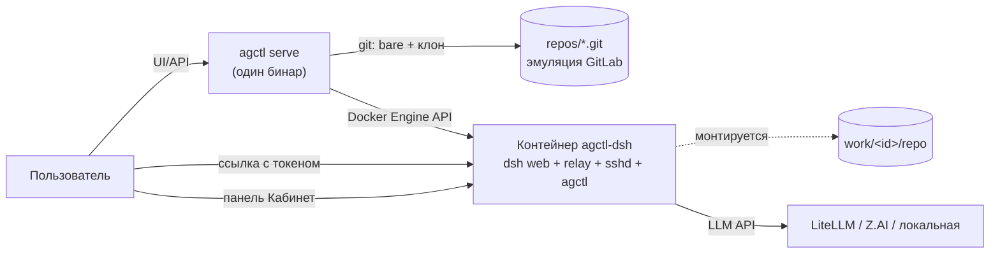

# agctl

**Платформа агентских рабочих мест одним Go-бинарём.** Кнопка «создать
контейнер + репку»: пользователь получает персональный git-репозиторий из
шаблона и Docker-контейнер с [DeepSeek Harness](https://www.npmjs.com/package/@deepseek-ai/dsh)
(`dsh web`), смонтированным на эту репку. Агент коммитит свою работу в git —
репозиторий становится долговременной версионированной памятью (скиллы +
бэклоги), которая переживает любые падения.

Панель «Кабинет» (клиент-плагин dsh) — в каждом воркспейсе из коробки:
управление местами, LLM-провайдером и SSH-доступом прямо из интерфейса агента.



## Быстрый старт (ноутбук, ~10 минут)

Нужно: **Go 1.27+**, **Docker** (Docker Desktop / dockerd), **Node 22+**
(для сборки UI).

```bash
git clone https://github.com/arijjia/agctl && cd agctl
make demo            # соберёт UI, бинар и образ agctl-dsh, поднимет сервер
```

Откройте `http://127.0.0.1:8929`:

1. **Регистрация** — первый пользователь становится админом.
2. **«Создать рабочее место»** — имя, стартовый комплект и компоненты (все
   включены по умолчанию; можно снять галочки), Base URL и модель
   LLM-провайдера (OpenAI-совместимый API: корпоративный LiteLLM, Z.AI,
   локальная модель), API-токен; опционально — SSH public key.
3. Через пару секунд статус станет «работает» — жмите **«Открыть»**:
   в новом табе откроется dsh web вашего личного агента с панелью
   **«Кабинет»** в боковой панели.

Агент уже умеет: коммитить после каждого шага (правила в `AGENTS.md`
репозитория), вести бэклог задач утилитой `agctl backlog` (формат
совместим с gitctl-экосистемой), править собственные скиллы в `skills/`.

Данные живут в `$AGCTL_HOME` (по умолчанию `~/.agctl`):

```
agctl.db                  SQLite: пользователи, воркспейсы, аудит
secrets.key               мастер-ключ шифрования токенов (0600)
repos/<owner>/<name>.git  bare-репозитории — «эмуляция GitLab»
work/<id>/repo            рабочие клоны (смонтированы в контейнеры)
work/<id>/dsh-home        DSH_HOME воркспейса (сессии, креды)
```

## Кабинет: три уровня платформы

| Уровень | Для кого | Что внутри | Среда |
|---|---|---|---|
| **Tier 0 — чат** | все (студенты, гуманитарии, сотрудники) | дефолтный dsh web: чат с инструментами, RAG-скиллы | среда создаётся лениво, только когда нужны инструменты |
| **Tier 1 — кабинет** | преподаватели, активные сотрудники | + личные файлы, LLM-провайдер на место, SSH-доступ | то же + опциональный контейнер |
| **Tier 2 — инженерное место** | разработчики, 1С, технические студии | полный dsh: терминал, git, скиллы, MCP, SSH-канал, Mutagen sync | постоянный контейнер с автосохранением |

Панель «Кабинет» появляется в боковой панели dsh web автоматически
(клиент-плагин сеется в dsh-home воркспейса при provision) и работает
same-origin через шлюз `/w/{id}/` — никаких CORS-настроек для базового
сценария не нужно. Исходник плагина: `dsh-plugins/cabinet/`.

## Стартовые комплекты и компоненты

При создании выбирается комплект и конкретные компоненты — чекбоксы включены
по умолчанию, поэтому типовой путь остаётся «одна кнопка»:

| Комплект | Компоненты по умолчанию |
|---|---|
| `base` | `core-workspace` (git-основа, бэклог, навык) + `core-instructions` (AGENTS.md, README) |
| `1c-vibe` | core-компоненты + инструкции 1С, tooling Jira/GitLab/BSL, демо-проект, навык 1C Vibe |

Встроенный versioned manifest v1 описан в `internal/provision/kits.go`; файлы
компонентов берутся из `internal/assets/templates/` и копируются в рабочую репу
в порядке комплекта (предметные правила накладываются на базовые). Выбранные IDs
сохраняются в SQLite и API. `/api/kits` — актуальный каталог комплектов,
`/api/templates` оставлен для legacy-клиентов. Пользовательская публикация новых
компонентов/маркетплейс пока не реализованы — см. design-карточку в agctl-hq.

## Команды бинарника

```
agctl serve     # UI + API + provision
agctl migrate   # накатить миграции SQLite
agctl backlog <new|list|top|check|start|done|cancel|note|migrate>
agctl connect --port SSH_PORT [--host HOST] [--identity KEY] [--print]
agctl sync create --name NAME --local DIR --port SSH_PORT [--host HOST] [--user root] [--print]
agctl sync list|pause|resume|flush|terminate [mutagen args]
agctl workspace create --user ЛОГИН --name ИМЯ --template base --base-url URL --model M --api-key KEY
agctl version
```

`agctl serve` — основные флаги:

| Флаг | Зачем |
|---|---|
| `--home DIR` | каталог данных (по умолчанию `~/.agctl`) |
| `--addr H:P` | слушающий адрес (по умолчанию `127.0.0.1:8929`) |
| `--image T` | тег образа воркспейса (по умолчанию `agctl-dsh:0.1.0`) |
| `--max-per-user N` | лимит мест на пользователя (по умолчанию 3) |
| `--secure-cookies` | флаг Secure у cookies (за HTTPS-ingress) |
| `--cors-origin LIST` | точные origins для панели Кабинета, через запятую; пусто = CORS выключен |

`agctl backlog` работает и на хосте, и **внутри контейнера** (бинар
вшит в образ) — им агент ведёт задачи воркспейса.

### SSH-канал воркспейса (opt-in)

При создании рабочего места можно передать `sshPubKey` (OpenSSH public key)
в `POST /api/workspaces`; для существующего — `PATCH /api/workspaces/{id}/ssh`
с `{ "pubKey": "ssh-ed25519 ..." }`. Ключ валидируется (`golang.org/x/crypto/ssh`)
и меняется только владельцем места. Публичный ключ хранится в SQLite;
приватный остаётся у пользователя. Контейнер запускает `sshd` только при
наличии ключа; root-вход — только public-key, пароли и forwarding запрещены.
SSH-порт контейнера публикуется Docker **только на 127.0.0.1 хоста** и виден
в поле `sshPort` ответа workspace. Изменение ключа на работающем месте
пересоздаёт контейнер.

Подключиться с самого сервера/хоста:

```sh
agctl connect --port <sshPort> --identity ~/.ssh/id_ed25519
```

Для удалённой машины сначала нужен доверенный TCP-путь до хоста (например,
администраторский SSH-туннель/VPN); `sshPort` намеренно не открыт в LAN или
Internet. Пример ручного туннеля: `ssh -L 22222:127.0.0.1:<sshPort> user@agctl-host`,
затем `agctl connect --host 127.0.0.1 --port 22222 --identity KEY`.

Локальную папку можно подключить к той же среде в real time через
[Mutagen](https://mutagen.io/documentation/synchronization/) (нужен установленный
[Mutagen CLI](https://mutagen.io/documentation/introduction/installation/)):

```sh
agctl sync create --name my-workspace --local ./repo \
  --host 127.0.0.1 --port <sshPort> --user root
agctl sync list
agctl sync pause my-workspace
agctl sync terminate my-workspace
```

Создаётся `two-way-safe` сессия (конфликты без потери данных остаются для
разрешения); VCS-метаданные, `node_modules`, `.env*`, `.credentials.*` и `.ssh`
исключены по умолчанию. Git остаётся источником истории/review. Для удалённой
машины сначала подними SSH-туннель, затем укажи его локальные host/port.
Проверь остальные проектные секреты и при необходимости настрой ignore-правила
Mutagen до запуска синхронизации.

## Сборка и проверки

| Цель | Что делает |
|---|---|
| `make go_build` / `go test` | бинар / тесты (`go test -race ./...` — полный прогон) |
| `make web_build` | React SPA → `web/dist` → `go:embed` |
| `make img_build` | linux-сборка agctl + docker-образ `agctl-dsh:0.1.0` (`IMG=agctl-dsh:X make img_build`) |
| `make release_local` | матрица darwin/linux/windows × arm64/amd64 в `dist/` |
| `make demo` | всё сразу + запуск сервера |
| `IMG=… scripts/e2e-cabinet.sh` | Docker e2e: образ → workspace → панель через шлюз; SSH off by default |
| `IMG=… scripts/e2e-ssh.sh` | Docker e2e SSH: ключ → sshd → shell → снятие/ротация ключа; опц. фаза real-Mutagen |
| `tests/e2e-ui` | Playwright: панель в сайдбаре, CORS-логин, создание места через браузер |

Релизы по тегу — [goreleaser](.goreleaser.yaml) (CI: `.github/workflows/ci.yml`).

## Безопасность (MVP-базис)

- изоляция: агент работает в контейнере, наружу монтируется только его репа;
- токены LLM: вводятся в личном кабинете, хранятся **зашифрованными**
  (AES-256-GCM, мастер-ключ 0600), передаются в контейнер через env,
  не попадают в Git и образы;
- пароли — argon2id, сессии — HttpOnly-cookie, первый пользователь — админ;
  `--secure-cookies` включает флаг Secure за HTTPS ingress;
- доступ к DSH UI идёт через `/w/{id}/`: проверка сессии/владельца,
  reverse proxy для HTTP и WebSocket, boot-токен DSH не попадает в ссылку;
- SSH: root — только public-key, пароли/forwarding запрещены, порт —
  только loopback хоста;
- CORS: allow-list точных origins (по умолчанию выключен), wildcard с
  credentials не поддерживается;
- аудит действий — журнал в админке; лимиты — память/CPU контейнеров и число
  воркспейсов на пользователя.

Подробная модель шлюза и остаточные риски — [docs/secure-gateway.md](docs/secure-gateway.md).
Архитектура v2 и дорожная карта — [docs/architecture.md](docs/architecture.md).
Стратегия (уровни платформы, теория сред) — штаб `agctl-hq/docs/agctl-platform-concept-v2.md`.

## Ограничения MVP (честно)

- DSH UI доступен через same-origin `/w/{id}/` с проверкой сессии и прав;
  Docker порт каждого контейнера остаётся привязан к `127.0.0.1:<порт>`.
  Для удалённого браузера нужен доверенный TLS ingress, направленный на agctl;
  включите `--secure-cookies`. Сам agctl TLS не терминирует. Доступ локальных
  процессов сервера к loopback-портам остаётся residual risk;
- SSH-порт также loopback-only: для машины пользователя вне сервера нужен
  туннель/VPN (намеренно — см. README-раздел выше);
- k3s-рантайм (вместо Docker) — следующий этап, интерфейс Runtime уже
  абстрагирован;
- автосохранение (commit+push) выполняет agctl каждые 2 минуты и при
  остановке: агент коммитит часто, agctl доставляет до bare-origin.

## Лицензия

[MIT](LICENSE)
