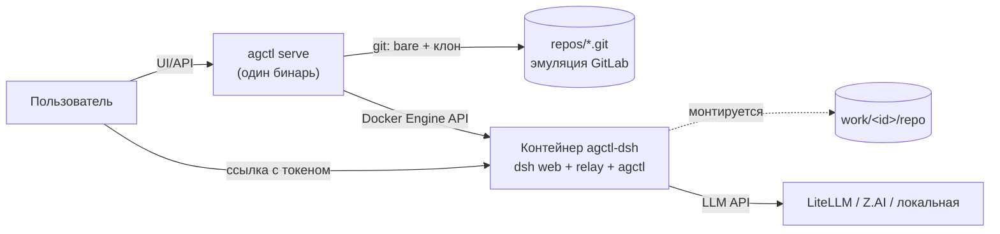

# agctl

**Платформа агентских рабочих мест одним Go-бинарь.** Кнопка «создать
контейнер + репку»: пользователь получает персональный git-репозиторий из
шаблона и Docker-контейнер с [DeepSeek Harness](https://www.npmjs.com/package/@deepseek-ai/dsh)
(`dsh web`), смонтированным на эту репу. Агент коммитит свою работу в git —
репозиторий становится долговременной версионированной памятью (скиллы +
бэклоги), которая переживает любые падения.



## Быстрый старт (ноутбук, ~10 минут)

Нужно: **Go 1.27+**, **Docker** (Docker Desktop / dockerd), **Node 22+**
(для сборки UI).

```bash
git clone https://github.com/arijjia/agctl && cd agctl
make demo            # соберёт UI, бинарь и образ agctl-dsh, поднимет сервер
```

Откройте `http://127.0.0.1:8929`:

1. **Регистрация** — первый пользователь становится админом.
2. **«Создать рабочее место»** — имя, Base URL и модель LLM-провайдера
   (OpenAI-совместимый API: корпоративный LiteLLM, Z.AI, локальная модель),
   API-токен.
3. Через пару секунд статус станет «работает» — жмите **«Открыть»**:
   в новом табе откроется dsh web вашего личного агента.

Агент уже умеет: коммитить после каждого шага (правила в `AGENTS.md`
репозитория), вести бэклог задач утилитой `agctl backlog` (формат
совместим с gitctl-экосистемой), править собственные скиллы в `skills/`.

Данные живут в `$AGCTL_HOME` (по умолчанию `~/.agctl`):

```
agctl.db                  SQLite: пользователи, воркспейсы, аудит
secrets.key               мастер-ключ шифрования токенов (0600)
repos/<owner>/<name>.git  bare-репозитории — «эмуляция GitLab»
work/<id>/repo            рабочие клоны (смонтированы в контейнеры)
work/<id>/dsh-home        DSH_HOME воркспейса (сессии, креды)
```

## Шаблоны репозиториев

При создании воркспейса выбирается шаблон репки:

| Шаблон | Для чего |
|---|---|
| `base` | универсальное рабочее место: частые коммиты, скилл бэклогов, саморедактируемые процедуры |
| `1c-vibe` | 1С-разработка: цикл **Jira → git-ветка → правка выгрузки 1С (XML/BSL) → самопроверка → MR** через `publish.py`; тулзы контура (jira/gitlab-клиенты) и демо-проект включены |

Свой шаблон = подкаталог в `internal/assets/templates/<id>/` + запись в
`provision.Templates`.

## Команды бинаря

```
agctl serve     # UI + API + provision (флаги: --home --addr --image --max-per-user)
agctl migrate   # накатить миграции SQLite
agctl backlog <new|list|top|check|start|done|cancel|note|migrate>
agctl version
```

`agctl backlog` работает и на хосте, и **внутри контейнера** (бинарь
вшит в образ) — им агент ведёт задачи воркспейса.

## Сборка

| Цель | Что делает |
|---|---|
| `make go_build` / `go test` | бинарь / тесты |
| `make web_build` | React SPA → `web/dist` → `go:embed` |
| `make img_build` | linux-сборка agctl + docker-образ `agctl-dsh:0.1.0` |
| `make release_local` | матрица darwin/linux/windows × arm64/amd64 в `dist/` |
| `make demo` | всё сразу + запуск сервера |

Релизы по тегу — [goreleaser](.goreleaser.yaml) (CI: `.github/workflows/ci.yml`).

## Безопасность (MVP-базис)

- изоляция: агент работает в контейнере, наружу монтируется только его репа;
- токены LLM: вводятся в личном кабинете, хранятся **зашифрованными**
  (AES-256-GCM, мастер-ключ 0600), передаются в контейнер через env,
  никогда не попадают в git/логи/образы (CI-гард gitleaks);
- пароли — argon2id, сессии — HttpOnly-cookie, первый пользователь — админ;
- аудит всех действий — журнал в админке;
- лимиты: память/CPU контейнеров, число воркспейсов на пользователя.

Подробный маппинг на требования ФСТЭК №117 / Методики 12.04.2026 / 243-ФЗ и
роадмап (k3s-runtime, SSO/MFA, логирование промптов, домены 1С и
«чат-ассистент») — в документации проекта.

## Ограничения MVP (честно)

- UI воркспейса публикуется на `127.0.0.1:<порт>` docker'ом: вход по
  boot-токену dsh, но порт локальный — рассчитано на личный ноутбук;
  сетевая аутентификация поверх — этап M2/M3 (см. роадмап);
- k3s-рантайм (вместо docker) — следующий этап, интерфейс Runtime уже
  абстрагирован;
- автосохранение (commit+push) выполняет agctl каждые 2 минуты и при
  остановке: агент коммитит часто, agctl доставляет до bare-origin.

## Лицензия

[MIT](LICENSE)
