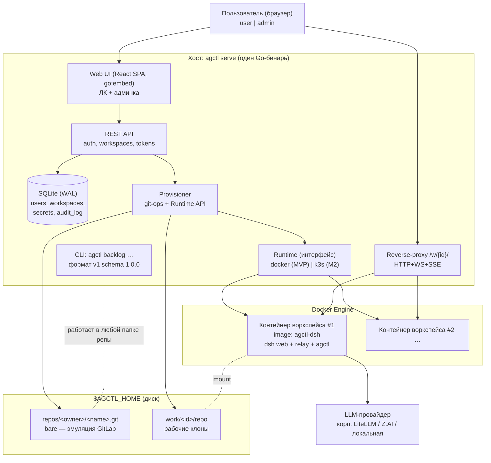
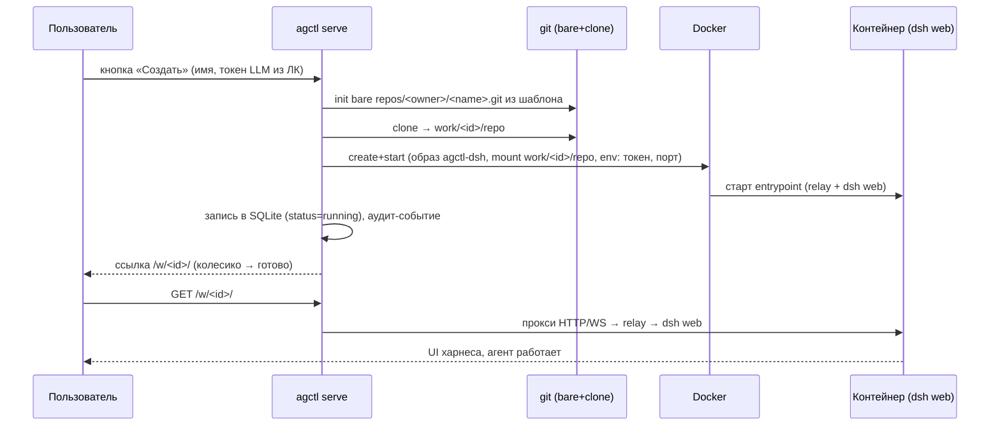

# agctl — архитектура и роадмап (v1)

> Дата: 2026-09-28. Источники: logs/Первомайская_улица_15.{md,txt},
> logs/Первомайская_улица_16.{md,txt} (обязательные критерии MVP), обзор
> 1c-vibe-hq / idp-hq / voproshalych-hq/docs/voproshalych-v3, бест-практисы
> kb/dsh (формат бэклогов v1, docker-образ dsh из mgmt, night-ops),
> требования ФСТЭК №117 + Методика 12.04.2026 + 243-ФЗ (таблица 44 пунктов).
> Статус: **M1 (MVP) реализован и проверен e2e на ноуте 2026-09-28** — см.
> раздел 13 «Журнал реализации»; код: arijjia/agctl.

## 1. Что такое agctl

**Одна кнопка «создать рабочее место агента».** Пользователь в личном
кабинете жмёт кнопку → платформа создаёт персональную git-репозиторию из
шаблона («эмуляция GitLab» — bare-репа в папке) и Docker-контейнер со
смонтированным рабочим клоном, внутри которого подняты DeepSeek Harness
(`dsh web`) и настроенная модель. Ссылка из кабинета ведёт на проксированный
UI харнеса — готовый агент с долговременной версионированной памятью
(скиллы + бэклоги в git).

Весь проект — **один Go-бинарь** (`agctl`): он и веб-сервер с UI, и бэкенд,
дёргающий git- и docker-ручки, и CLI ведения бэклогов внутри контейнера.
SQLite, никаких внешних БД. Docker-first (без кубов), k3s — следующим
этапом через ту же абстракцию. Кроссплатформенность: macOS / Linux / Windows.

Публичный код — `arijjia/agctl` (персональные заметки — здесь, в agctl-hq).
Цель — отчуждаемый опенсорс-тул: «выложил — люди разворачивают дома и в
компаниях».

### 1.1 Позиционирование среди смежных проектов

| Проект | Роль в картине | Что берём оттуда / что даём туда |
|---|---|---|
| **agctl** (этот план) | ядро: мультипользовательская инфра-платформа агентских рабочих мест | даёт всем трём нижестоящим: self-service, изоляцию, память, тулинг |
| **idp-hq** | стратегическая рамка IDP (self-service, секреты, жизненный цикл проекта, K8s) | agctl — её docker-first исполнение с DSH как агентным слоем; idp-этапы MVP→пилот→тираж совпадают с нашим роадмапом |
| **voproshalych-hq/docs/voproshalych-v3** | workload «чат-ассистент»: универсальный агент (LangGraph), БЗ, профили, скиллы> MCP | платформа даёт сотрудникам dsh-инстансы для ведения скиллов/БЗ; профиль «chat» (M5) — лёгкий воркспейс без IDE для «деревянных по пояс»; критика Dify подтверждает курс «код+git, не low-code» |
| **1c-vibe-hq** | специализированный домен: полный цикл 1С-задачи, скриншотная петля, Windows-VM | шаблон репы «1c-worker» и Windows-воркеры (M4); cleanroom-dsh.sh — уже готовый паттерн отчуждаемого dsh; харнес — заменяемый слой (проверено на dsh и opencode) |

## 2. Принципы (сводные, из диалогов + kb/dsh)

1. **Один бинарь, всё остальное — данные на диске.** Лучшие традиции
   кубернетесных утилит: скачал — запустил — работает.
2. **Истина — файлы и git.** Бэклог — файл в репо; UI/API — читатели.
   Персональная репка пользователя = его долговременная версионированная
   память (скиллы + карточки), самолечится через git revert.
3. **Секреты — никогда в git и образах.** Токены: ЛК → шифрованный стор →
   env контейнера. CI-гард на утечки.
4. **Изоляция контейнером.** Агент живёт в контейнере, монтируется только
   его репа; хост не доступен.
5. **Саморазвитие.** В шаблон репы кладётся AGENTS.md: «коммить часто,
   правь свои скиллы сам»; скилл «веди бэклоги» с вложенным agctl-бинарём.
6. **Один коммит — одна задача; тулинг всё зажимает и контрактрует**
   (меньше ошибок на слабых моделях).
7. **Минимум, ниже которого не упасть:** docker + git в двух местах
   (bare-origin «эмуляция GitLab» + смонтированный рабочий клон).

## 3. Архитектура

### 3.1 Обзор (C4-containers)



### 3.2 Состав бинаря

| Команда | Что делает |
|---|---|
| `agctl serve` | поднимает всё: static UI, REST API, прокси, фоновые задачи (autosave, health) |
| `agctl backlog new/note/start/done/cancel/check/list/top/migrate` | CLI бэклогов, формат v1 (schema 1.0.0) — совместим с gitctl-экосистемой; тот же бинарь лежит в образе контейнера |
| `agctl migrate` | миграции SQLite (плюс авто-миграция при старте serve) |
| `agctl version` | версия + digest сборки |

Внутренние пакеты: `server/` (UI+API+proxy), `auth/` (сессии, argon2id),
`store/` (sqlite, миграции), `provision/` (шаблон репы, git-ops),
`runtime/` (docker; k3s в M2), `backlog/` (CLI), `web/` (SPA).

### 3.3 Поток «создать воркспейс» (sequence MVP)



Фоновые задачи `serve`: периодический **autosave** (`git add -A && commit
&& push` в bare — safety net поверх коммитов самого агента по AGENTS.md),
health-check контейнеров, авто-стоп простаивающих (политика, M2+).

### 3.4 Каталоги и данные

```
$AGCTL_HOME/                     # default: ~/.agctl (serve флагом/ENV)
  agctl.db                       # SQLite WAL: users, workspaces, secrets, audit
  secrets.key                    # мастер-ключ шифрования секретов (0600)
  repos/<owner>/<name>.git       # bare-репы — «эмуляция GitLab»
  work/<ws-id>/repo              # рабочие клоны (монтируются в контейнеры)
  work/<ws-id>/dsh-home          # DSH_HOME воркспейса (сессии, креды) — переживает рестарт
```

Схема SQLite (минимум): `users(id, login, password_hash, role, created)`,
`workspaces(id, owner_id, name, repo_path, work_path, container_ref, port,
status, created, updated)`, `secrets(user_id, provider, ciphertext)`,
`audit_log(ts, actor, action, target, details)`.

### 3.5 Образ контейнера agctl-dsh (из kb/dsh/mgmt/docker — проверенный паттерн)

- base: `node:22-bookworm-slim`; dsh ставится **pinned тарболами** (не npm
  latest) — воспроизводимость и контроль целостности (digest в манифесте).
- **dsh слушает только loopback** → внутри образа L4-релей
  `0.0.0.0:3080 → 127.0.0.1:3099` (HTTP+WS проходят как есть);
  agctl-прокси стучится в контейнер:3080.
- DSH_HOME — volume `work/<id>/dsh-home`, скелет засеивается entrypoint-ом;
  профиль web преднастроен: модель/провайдер в конфиге, токен — из ENV
  (секрета в образе нет никогда).
- В образ положен тот же **agctl-бинарь** (multi-arch) — им работает скилл
  «веди бэклоги».
- MCP-прогрев npx-кэша на сборке (как в mgmt) — быстрый первый старт.

### 3.6 Аутентификация и прокси

- Вход agctl: логин-пароль (argon2id), cookie-сессии; роли `user`/`admin`
  (первая итерация может жить с одной ролью, но роль в схеме с первого дня).
- Доступ к `/w/{id}/` — только владелец (или админ); прокси прозрачен для
  WS/SSE. Вопрос аутентификации в самом dsh web (второй логин vs минт
  cookie бэкендом по образцу mgmt cookie-mint RPC) — см. раздел 11.
- Keycloak/OIDC — этап M3 (в логе №16: «потом, легко подключается»).

### 3.7 Абстракция Runtime (задел под k3s)

```go
type Runtime interface {
    Create(ctx, WorkspaceSpec) (ContainerRef, error) // образ, mounts, env, limits
    Start/Stop/Delete/Logs/List(...)
}
```

MVP: реализация над Docker Engine API (**unix socket** на mac/linux,
**named pipe** на windows — без shell-out на docker CLI). M2: реализация
над kube-API (Deployment per workspace, PV для work/, тот же прокси через
Service). UI/API не меняются — «демка на докере, вторая кнопка — на k3s».

## 4. Кроссплатформенность (mac / linux / windows)

- Go ≥1.27, **без cgo** (чистые зависимости) — тривиальный cross-compile.
- Матрица сборки (goreleaser + CI): `darwin/arm64, darwin/amd64,
  linux/amd64, linux/arm64, windows/amd64 (+windows/arm64)`.
- Docker: сокет `///var/run/docker.sock` vs `//./pipe/docker_engine` —
  выбор эндпоинта по ОС (или `DOCKER_HOST`).
- Пути — только `filepath`; никакой shell-логики без нужды; вся работа с
  git — через go-git (чистый Go), shell-out только как fallback.
- UI собран и вложен через `go:embed` — node в рантайме не нужен.
- Smoke-тесты бинаря на трёх ОС в CI (GitHub Actions matrix) — в т.ч.
  `agctl backlog check` на windows-раннере.

## 5. Безопасность: маппинг на требования (таблица 44 пунктов)

> Полная таблица требований — в logs/1.md. Здесь: как agctl закрывает
> каждую группу. Орг-меры (группа А) — комплект шаблонов документов в
> agctl-hq (M3): инвентаризация, классификация ИС, трёхуровневая система
> документов.

| Группа | Требование (сокр.) | Механизм agctl | Этап |
|---|---|---|---|
| А. Орг | инвентаризация, класс КЗ, политика | реестр воркспейсов/провайдеров в SQLite = живая инвентаризация; шаблоны документов в docs/ | M1 (реестр) / M3 (доки) |
| Б. №117 п.60 | исключить НСД; запрет передачи огр. данных разработчику модели | изоляция контейнером + доступ только к своим воркспейсам; профили провайдеров: корп. LiteLLM/локальные модели — данные не уходят наружу; egress-политика контейнера (allowlist) | M1 (изоляция) / M3 (egress) |
| В. №117 п.61 | шаблоны запросов/ответов, контроль тематики, сбор недостоверных, ограничение решений, доверенные технологии | прокси видит весь трафик: логирование промптов/ответов (opt-in), квоты, hook-фильтры тематики; сбор фидбэка «неверно» в карточки; провайдеры только из разрешённого списка | M1 (квоты-базис) / M3 (логи+фильтры) |
| Г. Методика 3.18 dev | изолированный сегмент, контроль целостности, анализ уязвимостей, без pickle, промпт-атаки при тестировании | pinned digest-ы образа и тарболов dsh; SBOM; CI: govulncheck + grype + gitleaks; сериализация только json/yaml; red-team-скилл (промпт-атаки) в тест-контуре | M1 (CI-гарды) / M3 (red-team) |
| Д. Методика 3.18 expl | класс КЗ ≥ ИС оператора; ИАФ/УПД/РСБ/АВЗ/МСЭ; MFA; квоты; аномалии; логирование запросов/ответов; проверка утечек | ИАФ: сессии (M1) → MFA/OIDC (M3); УПД: роли (M1); РСБ: audit_log всех действий + журналы прокси (M3); квоты per-user (M1 базис, M3 токены); детектор аномалий (M4); DLP-проверка ответов (M4) | поэтапно |
| Е. Особые (ПДн) | ГОСТ Р 56939-2024, сертификация | режим «закрытый контур»: только локальные/корп. модели, полный лог, без внешних egress; безопасная разработка — наш CI-процесс | M3–M4 |
| Ж. 243-ФЗ | суверенные БФМ | конфиг-профили OpenAI-compatible эндпоинтов (qwen и др. уже используются в 1c-vibe/voproshalych) — подмена провайдера без кода | M1 (механика) |
| З. Проект 2027 | ИИ-сегмент, MFA админов, минимальные права, фильтрация входа/выхода, квотирование входа, ограничение функциональности, защита от автономных агентов | архитектурно готово: всё трафик-управление в одном прокси-шлюзе agctl (фильтры, квоты, allowlist действий воркспейса); отдельный сегмент = отдельный деплой agctl | M3+ |

**MVP-минимум безопасности (не обсуждаемо):** изоляция контейнером,
секреты через env (не в git/логах/образе), argon2id+сессии+роли,
audit_log, лимиты ресурсов контейнеров (mem/cpu), максимум воркспейсов на
пользователя, CI-гарды на секреты.

## 6. MVP — обязательные критерии (Definition of Done)

Из logs/Первомайская_улица_16.md + безопасности. **Всё нижестоящее —
обязательно для первой демонстрации «на ноутбуке за вечер»; что не в этом
списке — не MVP.**

### Инфраструктура
1. **Один го-шный бинарь.** `agctl serve` одной командой поднимает UI,
   API, прокси и работает с git/docker-ручками. Никаких внешних сервисов
   кроме Docker Engine.
2. **Кроссплатформенность.** Сборки и запуск на darwin/linux/windows
   (amd64+arm64); CI-smoke на всех трёх ОС.
3. **Личный кабинет**: логин-пароль (без Keycloak), одна кнопка «создать
   контейнер+репка», колесико прогресса → ссылка. Один UI, роли
   user/admin.
4. **Кнопка «создать» делает связку**: bare-репа из шаблона в папке бэка
   (эмуляция GitLab) + рабочий клон + Docker-контейнер с этой репой.
5. **Ссылка ведёт на `/w/{id}/`** — тот же бинарь проксирует в контейнер:
   открывается dsh web, агент отвечает (живой чат, WS/SSE работают).
6. **Админка**: список всех воркспейсов (статус, владелец), кнопки
   старт/стоп/убить; список пользователей; журнал аудита.
7. **SQLite embedded** + авто-миграции схемы при старте (`agctl migrate` —
   вручную). Postgres — нет.

### Что бежит в контейнере
8. **Шаблон репы не пустой**: AGENTS.md (правило: коммить и пушь на каждый
   чих; правь свои скиллы сам), скилл «веди бэклоги», `backlog/` со
   стартер-карточкой, README, .gitignore.
9. **В образе**: преднастроенный dsh web (pinned) + relay (loopback-паттерн)
   + конфиг профиля (модель настроена, секрет — из переменной окружения) +
   agctl-бинарь для бэклогов.
10. **Токен LLM вводится в ЛК**, бэк подкидывает его в контейнер env-ом;
    в git/логи/образ он не попадает никогда (проверено CI-гардом).
11. **`agctl backlog new/list/...` работает** внутри контейнера на смонтированной репе (тем же бинарём из образа) и на хосте.

### Git/память
12. **Git в двух местах**: bare-origin (эмуляция GitLab) + смонтированный
    рабочий клон; push в origin — safety net (периодический autosave +
    при stop).
13. **Рестарт/стоп контейнера не теряет данные**: репа и DSH_HOME живут на
    хосте, повторный старт подхватывает историю.

### Демонстрация
14. **Демо на ноутбуке**: с `agctl serve` до работающего агента, который
    делает коммит в свою репку, — ≤ 10 минут и ≤ 2 клика пользователя
    (создать → перейти по ссылке).
15. **Autosave-пруф**: в bare-origin видна история коммитов агента после
    остановки контейнера.

## 7. Роадмап (этапы)

| Этап | Содержание | Критерий выхода |
|---|---|---|
| **M0. Каркас** (дни) | репо agctl: go-модуль, каркас cmd/internal, CI (test/lint/goreleaser/gitleaks), SQLite+миграции, каркас UI, mk-include Makefile | CI зелёный на 3 ОС; `agctl serve` отдаёт заглушку ЛК; `agctl backlog check` валидирует формат v1 |
| **M1. MVP** (1–2 недели) | всё из раздела 6: auth, шаблон репы, provisioner git+docker, образ agctl-dsh, прокси, админка, autosave, аудит, лимиты | все 15 критериев DoD; демо записано на видео |
| **M1.5. Опенсорс-полировка** (параллельно) | README (RU+EN quickstart), LICENSE, install-скрипт, пример .env, видео-демо в README, первая версия publish-флоу (goreleaser → release) | незнакомый человек поднимает за ≤10 мин по README |
| **M2. k3s-runtime** (неделя) | реализация Runtime над kube-API (k3s локально), PV для work/, тот же UI/API; helm-чарт агctl; выбор backend флагом `--runtime=docker\|k3s` | та же демка второй кнопкой на k3s |
| **M3. Security-хардненг** (1–2 недели) | OIDC/Keycloak + MFA; логирование запросов/ответов в прокси (opt-in); квотирование запросов/токенов; egress-allowlist контейнеров; фильтры тематики (п.61); комплект орг-документов (группа А); red-team промпт-тесты | чек-лист групп Б/В/Г/Д из раздела 5 закрыт по «M3» |
| **M4. Домен 1c-vibe** (по готовности ЦИТ) | шаблон репы «1c-worker»; Windows-воркеры (Hyper-V VM как runtime-цель); скриншотная петля (наблюдение→мультимодаль→действия→исполнитель→контроль); мост в хранилище 1С по образцу 1c-vibe | Jira-задача → ветка → самопроверка → MR из воркспейса agctl |
| **M5. Профиль «chat»** (voproshalych) | лёгкий воркспейс без IDE-морды: универсальный агент (LangGraph-стек v3 как workload), БЗ-скиллы, публичный агент абитуриентов/«бабушек»; SSO ТюмГУ через M3-слой | сотрудник ведёт скиллы в своём dsh-воркспейсе, публикует в chat-профиль |
| **M6. Research: плотность** (опционально) | замеры потребления dsh (вопрос из диалога №15!); sleep/wake воркспейсов; Substrate-подобное уплотнение — только когда упрёмся в ресурсы | N пользователей на «крошечной» ВМ при p95 задержке ≤500мс — или осознанный отказ |

## 8. Структура репозитория agctl (публичного)

```
agctl/
  cmd/agctl/main.go
  internal/
    server/        # HTTP: static embed, REST, reverse-proxy (WS/SSE)
    auth/          # сессии, argon2id, роли
    store/         # SQLite, миграции (embed)
    provision/     # шаблон репы, git-ops (go-git)
    runtime/       # interface Runtime; docker/ (M1), k3s/ (M2)
    backlog/       # CLI бэклогов v1 (парсер/валидатор/журнал)
    auditlog/      # РСБ-события
  web/             # React+Vite SPA → build → go:embed
  templates/repo/  # ШАБЛОН СОЗДАВАЕМОЙ РЕПЫ: AGENTS.md, skills/, backlog/, README
  images/agctl-dsh/# Dockerfile + entrypoint + relay + скелет DSH_HOME
  docs/            # architecture (эта дока — копия), security-mapping, runbook
  bin/*.mk + Makefile   # конвенция mk-include
  .goreleaser.yml  # матрица 3 ОС × 2 арха
```

agctl-hq (здесь): заметки, логи диалогов, орг-документы (группа А),
сырые исследования. Публичная копия архитектуры — синхронизируется в
agctl/docs/.

## 9. Заимствования из экосистемы kb/dsh

| Что | Откуда | Зачем |
|---|---|---|
| Формат бэклогов v1 (yaml-шапка, semver схемы, файл-на-задачу, append-only, open→done) | скилл backlog (gitctl-экосистема), kb/dsh/backlog | «этот же бинарь — add/edit backlog как в gitctl»; совместимость с gitctl backlog summary |
| Docker-образ dsh (pinned тарболы, DSH_HOME-volume, скелет, MCP-прогрев) | kb/dsh/mgmt/docker/{Dockerfile,entrypoint.sh,relay.mjs} | проверенный живым E2E способ бегать dsh web в контейнере |
| L4-релей loopback→eth0 | mgmt/docker/relay.mjs | dsh запрещает --host 0.0.0.0; релей решает |
| Cookie-mint RPC | mgmt/src/core/rpc.ts | кандидат для бесшовного входа в dsh web через прокси |
| Cleanroom-паттерн отчуждаемого dsh | 1c-vibe/scripts/cleanroom-dsh.sh | шаблон DSH_HOME с settings.yaml+credentials 600 |
| Коммит-гигиена и гарды | ~/.dsh/AGENTS.md, kb/dsh/AGENTS.md | один коммит = одна задача; pre-commit lint; секреты вне git |
| Night-ops ритуалы | kb/dsh/system/night-ops.md | деплой-гард, верификация по артефактам — для наших CI и демо |

## 10. Риски и открытые технические вопросы

1. **Аутентификация dsh web за прокси**: второй логин раздражает «бабушек»;
   cookie-mint бэкендом — предпочтительно, но требует стабильного RPC.
2. **go-git vs системный git**: go-git чист и кроссплатформенен, но слабее
   на больших репо/edge-cases; fallback на системный git — флагом.
3. **Docker на Windows** (named pipe + WSL2) — отдельный smoke-раннер в CI
   обязателен.
4. **Потребление dsh на пользователя** — замерить в M1 (открытый вопрос из
   диалога №15); от этого зависит плотность и нужда в M6.
5. **Правовой режим логирования промптов** (152-ФЗ) — для ТюмГУ-инстанса
   логирование opt-in по согласию; дефолт выкл.
6. **Секрет в 1c-vibe-hq/1.md** (LiteLLM-ключ в истории git) — ротация +
   чистка истории (см. «Хвосты» в сессии).
7. **Мультиарх образа agctl-dsh** (linux/amd64+arm64 минимум) — buildx в
   CI; windows-контейнеры не нужны (Windows — только про runtime M4).

## 11. Принятые решения (владелец, 2026-09-28)

| Вопрос | Решение | Следствие |
|---|---|---|
| UI-стек | **React SPA + Vite + TS, сборка в go:embed** | node только при разработке; в рантайме бинарь самодостаточен |
| Git-движок | **go-git, чистый Go** | ноль внешних зависимостей, Windows без установленного git; edge-cases больших репо не наш случай |
| Docker-доступ | **нативный Docker Engine API SDK** | unix socket (mac/linux) + named pipe (windows), без docker CLI |
| Security в MVP | **MVP-минимум (раздел 5), остальное в M3** | argon2id+сессии+роли, audit, изоляция, лимиты, секреты через env; прокси-логирование промптов — M3 |
| Лицензия | **MIT** | максимальный пермиссивный охват |
| Язык README/док | **только RU** | аудитория — RU-компании и вузы; EN — позже по потребности |

Решения раскладываются в бэклог-карточки `backlog/` этого репо при
старте M0 (вместе с развёртыванием backlog-формата — скилл backlog).

## 12. Definition of Done роадмапа как целого

Платформа считается состоявшейся, когда: (а) чужой человек поднимает
agctl по README за 10 минут и получает агентское рабочее место с памятью;
(б) демка на ноутбуке повторяема одним бинарём; (в) чек-лист раздела 5
закрыт по этапам M3; (г) домены 1c-vibe и voproshalych живут на ней как
шаблоны/workload-профили, не как отдельные инфраструктуры.

## 13. Журнал реализации (append-only)

### 2026-09-28 — M1 MVP реализован и проверен (агент, сессия agctl-hq)

Код: `arijjia/agctl`, коммиты `7dcc482` (ядро), `5c015cb` (SPA),
`1563d04` (фиксы dsh-auth/autosave/identity), `16f4d77` (CI+README).

Отклонения от раздела 3 (и почему):

1. **UI воркспейса — отдельный loopback-порт docker'а, а не под-путь
   `/w/{id}/` основного порта.** `/w/{id}` остался как авторизованный
   307-редирект. Причина: subpath-прокси требует переписывания абсолютных
   путей/фичефлагов UI харнеса; порт-прокси docker'а пропускает WS/SSE как
   есть — ноль кода на горячем пути, надёжно для демо. Сетевой прокси с
   принудительной аутентификацией — M2/M3.
2. **Вход в dsh web — boot-токен из журнала контейнера.** dsh печатает
   `?token=…` при старте; agctl скрейпит его (кэш + перескрейп после
   рестарта) и подставляет в ссылку «Открыть» — «бабушка» логинится один
   раз в саму платформу (cookie-mint RPC из mgmt — альтернатива на M2).
3. **Автосейв пушит и чистое дерево.** Агент обязан коммитить, но не пушить:
   autosave (2 мин + при стопе) доставляет до bare-origin в т.ч. чистое
   дерево с непушенными агентскими коммитами.
4. **Git-идентичность агента** задана system-конфигом образа и repo-local
   конфигом (agent@workspace.local) — иначе shell-git в контейнере отказывает.
5. Порт по умолчанию **8929** (8080 занят voproshalych-контейнером на ноуте).

Состояние DoD (раздел 6): пункты 1–15 выполнены и проверены живьём, кроме
финального шага демо №14 — «агент отвечает в чате», для которого нужен
реальный токен LLM в ЛК (в e2e использован фейковый; UI dsh загружается,
чатовое ядро не вызывалось намеренно). CI-гарды секретов — gitleaks в
workflow; замер потребления dsh (п.4 рисков) не делался.

Бэклог-кандидаты (в agctl/agctl-hq ещё нет `backlog/` — развернуть при
старте M1.5): спайк cookie-mint RPC вместо скрейпа токена; докер-джоб в CI
для сборки образа; квота «один provision за раз» → очередь; provider-профили
(выбор из справочника в ЛК вместо ручного Base URL).
